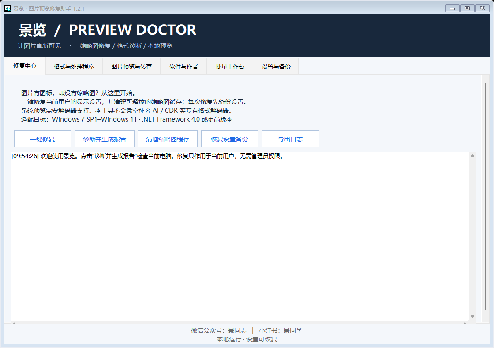
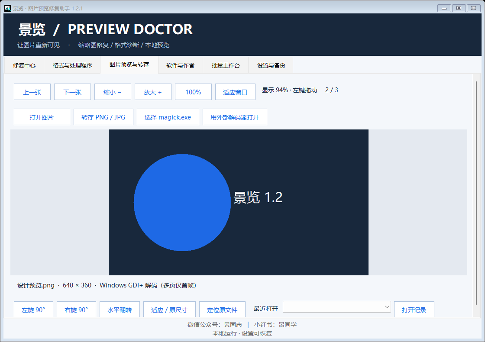
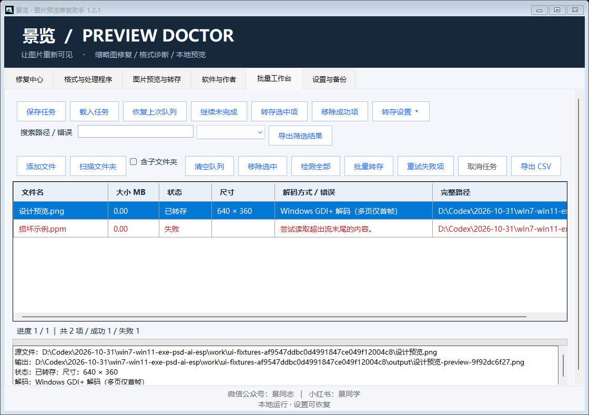

# Jing Preview Doctor (景览)


> Make images visible again — thumbnail repair / format diagnostics / local preview

**Jing Preview Doctor** is a local Windows tool for designers and photographers, focused on one common problem: **files that have an icon but no thumbnail**. It offers one-click repair of the current user's display settings, cleanup of reclaimable thumbnail caches, diagnostics of system format handlers, and a built-in lightweight image preview and batch re-save.

- Current version: **1.2.1**
- Environment: Windows 7 SP1 – Windows 11, requires .NET Framework 4.0 or higher
- Nature: **runs locally, no network, no telemetry**

---

## ✨ Features

- **Repair center**: one click fixes four display settings for the current user, auto-backing-up first, then enables thumbnails, preview handlers and cache; cleans removable `thumbcache_*.db` and notifies the Shell to refresh.
- **Diagnostic report**: per-file, actually tries the built-in / system decoder, produces a readable diagnostic report, exportable as a log.
- **Formats & handlers**: lists thumbnail and preview-pane registration for 42 extensions, distinguishing three capabilities: "in-app preview / system thumbnail / preview pane".
- **Image preview & re-save**: open or drop in an image, view at aspect ratio, rotate left/right, flip, fit to window; supports PNG / JPEG re-save (long-edge limit, JPEG quality 1–100, transparent areas filled white), and can call external ImageMagick for more formats.
- **Batch workbench**: multi-file / folder (including subfolders) scanning, path de-duplication, task queue, parallel decoding (separate process, 30-second timeout), result filtering and CSV export.
- **Task persistence**: the queue can be saved as `.jingqueue`, the last queue is recorded automatically, supporting "resume unfinished / re-save selected / remove succeeded".
- **Settings & backup**: manual backup, backup restore, centralized log and output directory management, Shell refresh; auto-backup before every repair, restore affects settings only.

## 🖼 Screenshots

| Repair center (home) | Image preview & re-save | Batch workbench |
| --- | --- | --- |
|  |  |  |

> Left: one-click repair and diagnostics; middle: aspect-ratio view, rotate/flip, PNG/JPEG re-save; right: batch scan, decode detection and result export.

## 📥 Download

Get the latest version from **Releases**:

- **Single-file build** `JingPreviewDoctor.exe`: no companion DLLs needed, double-click to run (still requires system .NET Framework 4.0+).
- **Installer** `JingPreviewDoctor-Setup.exe`: per-user install, with Start Menu entry and system "Apps & features" uninstall entry.

> GitHub Releases page: <https://github.com/jingpanlong/JingPreviewDoctor/releases>

A `SHA256.txt` manifest is included for integrity verification. The program and installer are not digitally signed; Windows may show an unknown publisher — verify as needed.

## 🚀 Steps

1. Run the main program and click "Diagnose and generate report".
2. Click "One-click repair": after auto-backing-up the current user's display settings, it enables thumbnails, preview handlers and cache, and cleans removable caches.
3. Reopen the folder and switch to medium / large icons; `Alt + P` toggles the preview pane. Caches held by Explorer are skipped; you can sign out and back in to retry (the program does not terminate Explorer).
4. If a proprietary format still has no preview, check the existing registration in "Formats & handlers"; formats without an installed handler cannot be fixed by settings alone.
5. "Restore settings backup" selects a `backup-*.xml` and restores settings only (the cache can be rebuilt by the system).

## 📐 Support & limitations (please read)

There is no real guarantee that "every format can be repaired". This program **does not install a Shell extension** and adds no AI / CDR / PDF / RAW decoding capability to the system.

- **Built-in support**: JPG / JPEG / PNG / BMP / GIF / TIFF / ICO (GDI+, animation / multi-page first frame only); PSD v1 only, 8-bit RGB / grayscale, raw or PackBits RLE composite; PNM / PPM / PGM / PBM P1–P6 (8/16-bit samples, no PAM / PFM).
- **Not built-in**: PSB, AI, EPS, PDF, RAW family, CDR, EXR, HDR, WEBP, HEIC, AVIF, SVG, TGA, DDS, etc. Try an installed Shell handler or external ImageMagick; capability depends on file version, build and dependencies, not guaranteed per format.
- **Input limits**: built-in preview input cap 512 MB / 24 megapixels; Shell thumbnail up to 1024 px; external preview up to 1600 px. What is re-saved is a preview image, not a lossless original export or RAW development.
- If system policy forbids preview, settings are not modified — contact your admin; corrupt files, insufficient permissions, undownloaded cloud files, and codec crashes are outside one-click repair.

## 🔧 Build from source

No NuGet needed; uses the system's .NET Framework C# compiler.

```powershell
# In the source directory (requires .NET Framework 4.0+)
powershell -ExecutionPolicy Bypass -File build.ps1
```

Outputs in `dist/`:
- `dist/JingPreviewDoctor.exe` — single-file main program
- `dist/JingPreviewDoctor-Setup.exe` — per-user installer
- `dist/使用说明.txt` — usage notes (also embedded in the installer)

Self-test & verification (for developers):

```text
JingPreviewDoctor.exe --self-test report-path
JingPreviewDoctor.exe --ui-smoke-test report-path
JingPreviewDoctor.exe --screenshot output-PNG-path [page-key window-size]
JingPreviewDoctor-Setup.exe --self-test report-path
```

## 🔒 Privacy & locations

- The main program makes **no network requests, no telemetry**; original images are not auto-modified, and the re-save target path is chosen by the user.
- Logs & backups: `%LOCALAPPDATA%\JingPreviewDoctor`
- Install directory: `%LOCALAPPDATA%\Programs\JingPreviewDoctor`
- Uninstall keeps logs, settings backups and the repaired settings; to roll back settings, restore the backup before uninstalling.

## 📄 Open-source license

This project is open source under the [MIT License](./LICENSE).

## 📮 Contact author

- WeChat Official Account: **景同志**
- Xiaohongshu: **景同学**
- Repository & Issues: <https://github.com/jingpanlong/JingPreviewDoctor>

---

*Jing Preview Doctor — gives setting problems a repair entry, and format limits a clear explanation.*
